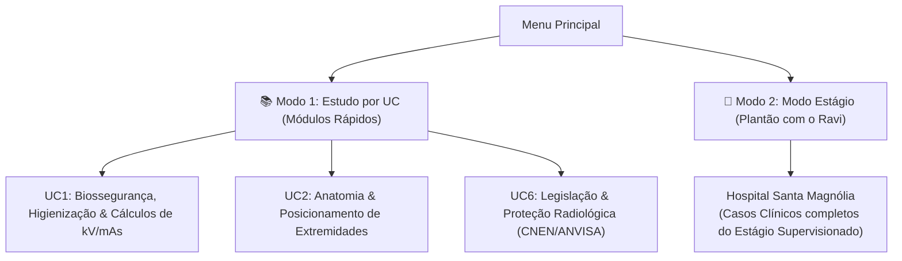

# 🏥 Plantão de Raios-X
> **Projeto Integrador | Curso Técnico em Radiologia — Senac Campinas**

Um jogo educativo interativo e simulador em **Ren'Py** e **Python** voltado para estudantes e profissionais de radiologia médica. O jogo aborda de forma prática e interativa os desafios reais do setor de radiologia hospitalar: biossegurança, atendimento humanizado, anamnese, fatores de exposição (kV/mAs), posicionamento radiográfico e análise de qualidade de imagens.

---

## 🎮 Modos de Jogo

O jogo possui dois modos principais de acesso:



1. **📚 Modo Estudo por Unidade Curricular (UC):**
   * Módulos independentes e quizzes rápidos para treinar competências específicas das disciplinas do Senac sem precisar passar por toda a narrativa.
2. **🏥 Modo Estágio (Plantão Supervisionado):**
   * O jogador assume o papel do estagiário **Ravi** no Hospital Santa Magnólia, enfrentando o fluxo completo de atendimento de 6 etapas por paciente sob a mentoria da **Supervisora Cláudia**.

---

## 📂 Estrutura do Repositório

```text
plantao-de-raios-x/
├── .gitignore
├── README.md
├── GDD.md                      # Game Design Document completo
├── flake.nix                   # Ambiente de desenvolvimento Nix (Ren'Py + Python)
└── game/
    ├── script.rpy              # Ponto de entrada e seletor de modos
    ├── options.rpy             # Configurações do jogo (título, resolução, etc.)
    ├── gui.rpy                 # Customizações visuais
    ├── screens.rpy             # Telas e menus interativos
    ├── personagens.rpy         # Definições de personagens e diálogos
    ├── modos/
    │   ├── modo_estagio.rpy    # Fluxo narrativo do estágio supervisionado
    │   └── modo_estudo_uc.rpy  # Hub de navegação por UC
    ├── ucs/                    # Quizzes e conteúdos específicos por UC
    │   ├── uc1/
    │   ├── uc2/
    │   └── uc6/
    ├── minigames/              # Minigames em Python (checklists, sliders de kV/mAs)
    ├── quiz/                   # Módulos de quiz e validação
    └── assets/                 # Backgrounds, sprites, radiografias e UI
```

---

## 🚀 Como Executar o Jogo

### Opção 1: Via Nix Shell (Ambiente Isolado)
```bash
nix develop -c renpy .
```

### Opção 2: Via Ren'Py Launcher
1. Abra o **Ren'Py Launcher**.
2. Adicione a pasta `plantao-de-raios-x` como diretório de projetos.
3. Clique em **Launch Project**.

---

## 🌿 Diretrizes de Desenvolvimento e Git Flow

Para manter o repositório organizado e profissional:
* Consulte o guia completo em **[`GIT_FLOW.md`](file:///home/henrique/Modelos/plantao-de-raios-x/GIT_FLOW.md)** para entender a estratégia de branches (`main`, `develop`, `feat/*`, `fix/*`) e o padrão de mensagens de commit.
* Consulte o **[`GDD.md`](file:///home/henrique/Modelos/plantao-de-raios-x/GDD.md)** para detalhes pedagógicos e mecânicas dos casos clínicos.

