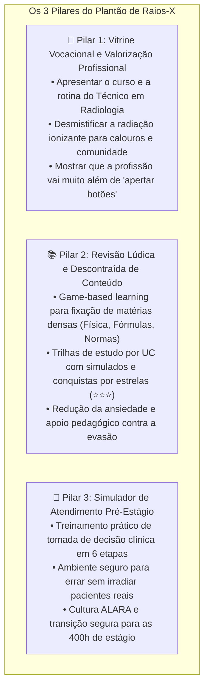
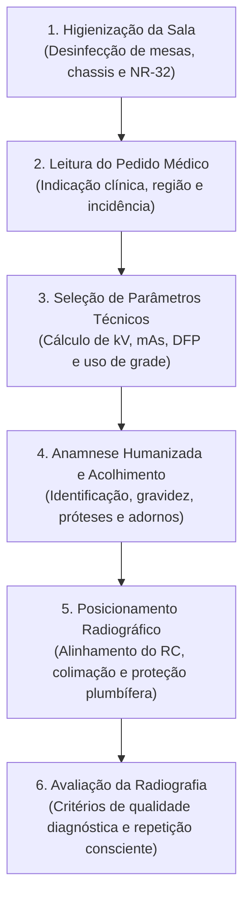

# 🩻 Apresentação do Projeto Integrador (UC 16)
## **Plantão de Raios-X: Plataforma Gamificada para Valorização da Profissão, Revisão de Aulas e Simulação Clínica**

> **Curso:** Técnico em Radiologia — Senac Campinas / SP  
> **Unidade Curricular:** UC 16 — Projeto Integrador Técnico em Radiologia  
> **Turma:** 18521 (006P)  
> **Tempo de Apresentação:** 15 minutos (+ 10 minutos de arguição da banca)  
> **Produto Técnico Entregável:** Jogo e Plataforma Educacional Interativa em Ren'Py 8 + Python 3  

---

## 🌟 A Visão Expandida: Os 3 Pilares Estratégicos do Projeto

---

## 🧭 Mapa da Apresentação em 12 Slides

```mermaid
flowchart LR
    A["1. Capa & Proposta"] --> B["2. Os 3 Pilares"] --> C["3. Situação-Problema Multidimensional"]
    C --> D["4. Objetivos Expandidos"] --> E["5. Tripé Normativo"] --> F["6. Metodologia 5W2H"]
    F --> G["7. A Plataforma e Modos"] --> H["8. As 6 Etapas do Atendimento"] --> I["9. Gamificação & Pontuação"]
    I --> J["10. Demonstração / Casos"] --> K["11. Impacto Institucional & Extensão"] --> L["12. Conclusão & CRTR"]
```

---

## 🖥️ Slide a Slide: Conteúdo Visual e Roteiro de Fala (Script)

---

### 📌 SLIDE 1: Capa e Identificação Institucional
* **Título do Projeto:** Plantão de Raios-X — Plataforma Gamificada de Aprendizagem e Simulação Radiológica
* **Subtítulo:** Apresentação da carreira, fixação de conteúdos acadêmicos e capacitação clínica para o estágio
* **Instituição:** Senac Campinas / SP
* **Unidade Curricular:** UC 16 — Projeto Integrador
* **Autor(es):** Henrique Freire (e grupo de trabalho)
* **Docentes Orientadoras:** Profª Viviane Roberta Bernardes e Profª Cleide Mara Rosa da Silva

> 🎙️ **Roteiro de Fala (Tempo: 01:00 min):**  
> *"Bom dia à banca examinadora, professoras orientadoras e colegas. Hoje apresentamos o nosso Projeto Integrador da UC 16: o **'Plantão de Raios-X'**. Este projeto nasceu com um propósito triplo: ser uma vitrine da nossa profissão para a sociedade e novos alunos, uma ferramenta leve e divertida para revisar conteúdos desafiadores de sala de aula e um simulador prático para capacitar o estudante antes do estágio hospitalar."*

---

### 📌 SLIDE 2: Os Três Pilares do Projeto Integrador
* **Pilar 1 — Apresentação da Profissão (Vocacional):**
  * Revela o papel crucial do técnico na cadeia diagnóstica da saúde.
  * Desmistifica mitos populares sobre radiação ionizante e biossegurança.
* **Pilar 2 — Revisão Lúdica de Aulas (Pedagógico):**
  * Transforma matérias densas (Física, Legislação e Parâmetros) em minigames e quizzes interativos.
  * *Game-Based Learning* para engajamento e redução da evasão escolar no início do curso.
* **Pilar 3 — Simulação Clínica Pré-Estágio (Técnico):**
  * Experiência imersiva no Hospital Santa Magnólia com atendimento em 6 etapas.
  * Segurança psicológica: o estudante treina o raciocínio sem risco radiológico a terceiros.

> 🎙️ **Roteiro de Fala (Tempo: 01:30 min):**  
> *"Nossa proposta vai muito além de um simulador isolado. Primeiro, o jogo funciona como porta de entrada para quem quer conhecer a radiologia, valorizando a profissão e mostrando que nosso trabalho exige ciência e humanização. Segundo, ele é um hub de estudos para revisar a matéria entre uma aula e outra de forma leve. E terceiro, ele prepara o aluno para a responsabilidade real do estágio supervisionado."*

---

### 📌 SLIDE 3: A Situação-Problema Multidimensional
* **No Âmbito Social/Vocacional:** O desconhecimento público sobre a formação técnica em radiologia (a crença equivocada de que o profissional é mero 'apertador de botão').
* **No Âmbito da Sala de Aula:** Conteúdos densos de física do tubo, cálculo de constante ($kV = 2E + C$) e normas sanitárias que geram sobrecarga cognitiva se estudados apenas por apostilas passivas.
* **No Âmbito do Estágio (Hospital):** Ansiedade intensa no primeiro contato com o paciente real, gerando hesitação em parâmetros técnicos e risco de repetição de doses.

> 🎙️ **Roteiro de Fala (Tempo: 01:30 min):**  
> *"Mapeamos três grandes dores na nossa jornada formativa: para a comunidade, a radiologia ainda é vista com preconceito ou desconhecimento; em sala de aula, a física e os cálculos assustam muitos colegas nos primeiros semestres; e na chegada ao hospital, o medo de errar a técnica com o paciente deitado na mesa é paralisante. Nosso projeto foi desenhado para solucionar esses três desafios simultaneamente."*

---

### 📌 SLIDE 4: Objetivos do Projeto
* **Objetivo Geral:**
  * Desenvolver uma ferramenta digital interativa e gamificada em Ren'Py/Python para apresentação vocacional, apoio pedagógico e simulação clínica no curso Técnico em Radiologia.
* **Objetivos Específicos:**
  * Divulgar a rotina e o valor social do Técnico em Radiologia de forma acessível e acolhedora.
  * Criar módulos de estudo organizados por Unidade Curricular (**UC 1**, **UC 2**, **UC 6**) com desafios rápidos e progressão por estrelas.
  * Simular o fluxo de atendimento hospitalar em **6 etapas clínicas padronizadas**.
  * Consolidar a cultura de conformidade regulatória (**CNEN**, **ANVISA**, **NR-32**) e humanização no atendimento.

> 🎙️ **Roteiro de Fala (Tempo: 01:00 min):**  
> *"Definimos objetivos claros: construir uma plataforma aberta, leve e intuitiva que ensine a física com leveza, demonstre o valor do técnico em radiologia na equipe médica e ofereça um campo de treinamento seguro para a tomada de decisão clínica."*

---

### 📌 SLIDE 5: O Tripé Normativo e Rigor Científico
* **Legislação e Regulamentação Sanitária:**
  * **CNEN NN 3.01:** Princípios de Proteção Radiológica (Justificação, Otimização/ALARA, Limitação de Dose - 20 mSv/ano) e dosimetria.
  * **ANVISA RDC nº 611/2022:** Requisitos de garantia da qualidade, colimação estrita, proteção de gônadas/tireoide e manutenção de registros.
  * **MTE NR-32:** Segurança do trabalhador, descarte seguro de infectantes e **conservação de aventais plumbíferos em cabides adequados (nunca dobrar)**.
* **Tratados e Literatura Técnica:**
  * *Bontrager* — Posicionamento radiográfico, anatomia e critérios de avaliação de imagem.
  * *Bushong* — Física das radiações, efeito termoiônico, produção de freamento/característica e radiobiologia.
  * *Biasoli* — Fórmulas operacionais e técnicas hospitalares.

> 🎙️ **Roteiro de Fala (Tempo: 01:30 min):**  
> *"Mesmo tendo uma linguagem leve e amigável, o projeto não abre mão do rigor científico absoluto. Todo o conteúdo foi desenvolvido com base nas normas da CNEN, na RDC 611 da ANVISA e na NR-32. As incidências anatômicas e os parâmetros operacionais são fundamentados em Bontrager e Bushong."*

---

### 📌 SLIDE 6: Metodologia e Planejamento (Matriz 5W2H)

| 5W2H | Aplicação Prática no Projeto |
| :--- | :--- |
| **What (O quê)** | Plataforma gamificada interativa ("Plantão de Raios-X") com módulos de estudo e simulação. |
| **Why (Por quê)** | Valorizar a profissão, dinamizar a revisão de aulas e capacitar com segurança para o estágio. |
| **Where (Onde)** | Desenvolvido no Senac Campinas, acessível via PC (Linux/Windows) e smartphones Android. |
| **When (Quando)** | Maio a setembro de 2026, cobrindo as Etapas I, II e III da UC 16. |
| **Who (Quem)** | Grupo de estudantes do curso técnico sob orientação das docentes de Radiologia. |
| **How (Como)** | Engine Ren'Py 8 + lógica Python 3, arquitetura modular, versionamento Git Flow e design centrado no aluno. |
| **How Much (Quanto)** | Custo zero em licenciamento (tecnologias 100% de código aberto e comunitárias). |

> 🎙️ **Roteiro de Fala (Tempo: 01:00 min):**  
> *"Aplicamos a metodologia 5W2H e boas práticas de versionamento no desenvolvimento. Priorizamos ferramentas open-source para assegurar que qualquer estudante, independente do poder aquisitivo ou do computador que possua, possa executar o jogo e estudar de qualquer lugar."*

---

### 📌 SLIDE 7: A Estrutura da Plataforma: Modos de Jogo
* **1. Menu Inicial e Apresentação da Carreira:**
  * Tela interativa com informações sobre o curso do Senac, o papel do CRTR e o perfil profissional.
* **2. Modo Estudo por Disciplina (UC):**
  * Trilhas temáticas dinâmicas para fixação de matérias:
    * **UC 1:** Física do tubo, efeito anódico, cálculo de $kV$, regras de distância e biossegurança.
    * **UC 2:** Anatomia de membros superiores e inferiores, acidentes ósseos e incidências de rotina.
    * **UC 6:** Legislação da CNEN, fiscalização da vigilância sanitária e radioproteção.
  * Simulados integrados com premiação por medalhas e estrelas (⭐⭐⭐).
* **3. Modo Estágio Supervisionado (O Plantão com o Ravi):**
  * Vivência no Hospital Santa Magnólia acompanhando a preceptora Supervisora Cláudia.

> 🎙️ **Roteiro de Fala (Tempo: 01:30 min):**  
> *"A arquitetura do jogo é dividida de forma inteligente: quem está conhecendo a área acessa a visão da carreira; quem precisa estudar para a aula de amanhã acessa o 'Modo Estudo por UC' para fazer quizzes e fixar fórmulas; e quem vai para o estágio entra no 'Modo Plantão' para vivenciar casos clínicos reais com o protagonista Ravi e a preceptora Cláudia."*

---

### 📌 SLIDE 8: O Fluxo Clínico do Simulador em 6 Etapas

> 🎙️ **Roteiro de Fala (Tempo: 01:30 min):**  
> *"No simulador de atendimento, estruturamos a rotina hospitalar em 6 etapas sequenciais: o aluno começa higienizando a sala; interpreta a solicitação médica; calcula a dose e parâmetros técnicos; realiza uma anamnese acolhedora checando gravidez e adornos metálicos; posiciona o paciente com colimação rigorosa; e avalia a imagem radiográfica com critérios de controle de qualidade."*

---

### 📌 SLIDE 9: Gamificação, Pontuação Formativa e Cultura ALARA
* **Pontuação Base:** 140 pontos por caso clínico atendido.
* **Penalidades Críticas (Segurança e Ética):**
  * Esquecer de perguntar sobre gestação em mulheres em idade fértil: **-20 pts** + alerta grave.
  * Disparar radiação fora da cabine blindada: **-15 pts**.
  * Aceitar imagem inadequada ou com corte anatômico: **-15 pts**.
  * Repetir exame desnecessariamente (aumento injustificado de dose): **-10 pts**.
* **Avaliação Alinhada ao Senac:**
  * **Desenvolvido (D):** Desempenho acima de 70% com respeito irrestrito às normas de proteção.
  * **Não Desenvolvido (ND):** Repetição orientada com justificativa pedagógica e reforço conceitual.

> 🎙️ **Roteiro de Fala (Tempo: 01:30 min):**  
> *"O sistema de pontuação é educativo e reforça a responsabilidade profissional. Ações que ferem o princípio ALARA ou a segurança do paciente têm penalizações severas. O jogo não apenas pontua, ele exibe um feedback explicativo conectando o erro à regra sanitária correspondente."*

---

### 📌 SLIDE 10: Demonstração Prática (Casos Clínicos e Telas)
* **Caso 1 — Seu Benedito (72 anos):** Tórax PA e Perfil (Tosse crônica).
  * Foco: Comunicação clara com idosos, ortostatismo e DFP a 180 cm para evitar aumento da área cardíaca.
* **Caso 2 — Júlia (24 anos):** Mão AP e Oblíqua (Trauma esportivo).
  * Foco: Colimação fechada, proteção gonadal e identificação de fratura no escafoide.
* **Caso 5 — Pedro (8 anos acompanhado da mãe):** Antebraço AP e Perfil (Trauma pediátrico).
  * Foco: Paramentação da mãe com avental e protetor de tireoide e fatores de dose ultrabaixa.

> 🎙️ **Roteiro de Fala (Tempo: 02:00 min):**  
> *(Demonstrar telas do jogo em funcionamento ou vídeo de 1 minuto com a interface do console de controle, o diálogo humanizado com o paciente e a tela final de resultados com estrelas).*  
> *"Na tela vemos como o estudante interage de forma fluida: ele visualiza o paciente, define a conduta técnica e recebe a análise imediata de suas decisões."*

---

### 📌 SLIDE 11: Impacto Educacional, Extensão e Viabilidade
* **Impacto Pedagógico:**
  * Fixação intuitiva de cálculos de console ($kVp = 2E + C$) e leis físicas.
  * Aumento da autoconfiança e segurança psicológica antes da ida aos hospitais conveniados.
  * Redução da sobrecarga de estudos com uma metodologia ativa e descontraída.
* **Potencial de Extensão Institucional no Senac:**
  * Pode ser adotado como ferramenta oficial de nivelamento em laboratório de informática.
  * Pode ser utilizado em feiras de profissões, eventos abertos do Senac e visitas escolares para apresentar a carreira de Radiologia.

> 🎙️ **Roteiro de Fala (Tempo: 01:00 min):**  
> *"Em termos de impacto e viabilidade (Indicador 2 do Senac), este projeto atende tanto ao ambiente interno quanto externo: dentro da escola, ele dinamiza as aulas e prepara os estudantes para o estágio; fora da escola, ele pode ser levado a feiras de profissões e eventos institucionais para divulgar o curso e atrair novos talentos para a radiologia."*

---

### 📌 SLIDE 12: Conclusão, Legado Profissional e Agradecimentos
* **A Identidade do Técnico em Radiologia:**
  * Um profissional de saúde qualificado, ético, humanizado e indispensável no suporte à vida.
* **Alinhamento com o CONTER / CRTR:**
  * Defesa da ciência, proteção radiológica intransigente e valorização contínua da categoria.
* **Agradecimentos:**
  * Ao corpo docente e à coordenação do Senac Campinas.
  * Às professoras orientadoras e aos colegas de turma.
* **Abertura:** *"Agradecemos a atenção de todos e estamos à disposição da banca examinadora!"*

> 🎙️ **Roteiro de Fala (Tempo: 01:00 min):**  
> *"Para concluir, o 'Plantão de Raios-X' consolida a nossa visão de que aprender radiologia pode ser uma experiência envolvente, rigorosa e transformadora. Demonstramos que o técnico do século XXI domina a física, cumpre as normas sanitárias e cuida do ser humano com dignidade. Muito obrigado a todos e estamos prontos para as considerações da banca!"*

---

## ⏱️ Grade de Cronometragem da Apresentação (15 Minutos)

| Bloco | Slides | Tempo | Foco da Mensagem |
| :--- | :---: | :---: | :--- |
| **Abertura & Os 3 Pilares** | 1 a 4 | **04:30 min** | Apresentação, vitrine da profissão, revisão lúdica e objetivos. |
| **Fundamentação & Método** | 5 e 6 | **02:30 min** | Tripé normativo (CNEN, ANVISA, NR-32), Bontrager e 5W2H. |
| **A Plataforma & Demonstração** | 7 a 10 | **05:30 min** | Modos de estudo por UC, fluxo em 6 etapas, pontuação e demo ao vivo. |
| **Impacto, Conclusão & Defesa** | 11 e 12 | **02:30 min** | Uso no Senac, divulgação do curso, CRTR e encerramento. |
| **Total** | **12 slides** | **15:00 min** | **Controle absoluto do tempo perante a banca** |

---

## 🛡️ Guia Rápido de Respostas para a Arguição da Banca

| Pergunta Provável da Banca | Como Responder com Segurança e Autoridade Técnica? |
| :--- | :--- |
| *"Qual o principal ganho de usar gamificação para ensinar radiologia?"* | *"A gamificação transforma o estudo passivo em **aprendizagem ativa por tomada de decisão**. Em vez de apenas ler que o avental não pode ser dobrado ou memorizar a fórmula de kV, o estudante aplica a regra em cenários realistas e visualiza as consequências de suas escolhas de forma imediata e sem riscos."* |
| *"Como essa ferramenta pode ajudar o Senac além do estágio?"* | *"Ela atua na **permanência escolar**, ajudando calouros a superar as dificuldades iniciais de física e cálculos sem desmotivação, e serve como **ferramenta de atração e extensão**, podendo ser exposta em feiras e mostras de cursos para apresentar a radiologia de forma moderna e cativante."* |
| *"Como foi garantido o rigor dos dados técnicos no jogo?"* | *"Todo o conteúdo foi validado com base na literatura clássica (Bontrager, Bushong, Biasoli) e na hierarquia legal brasileira (normas da CNEN, RDC ANVISA nº 611 e NR-32 do Ministério do Trabalho), assegurando que o tom descontraído preserve 100% da fidelidade científica."* |

---
*Documento homologado para o Projeto Integrador (UC 16) — Curso Técnico em Radiologia Senac Campinas.*
